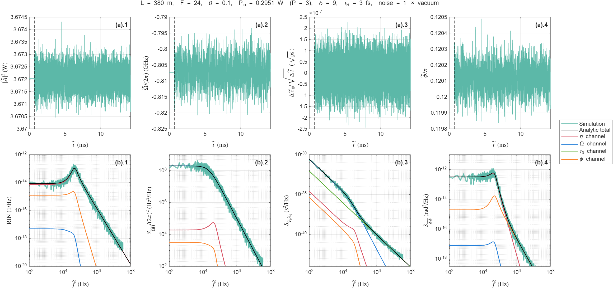

# Reduced-model noise spectra of a Kerr cavity soliton

**Author:** Yifan Sun (yifan.sun@ulb.be), Service OPERA-Photonics, Université libre de Bruxelles (ULB),
B-1050 Brussels, Belgium

MATLAB code for the four-coordinate reduced model of

> Y. Sun, et al. Collective-Coordinate Fluctuations of Driven-Dissipative Solitons,
> arXiv:2605.14614 [physics.optics] (2026). <https://arxiv.org/abs/2605.14614>

Please cite this paper if you use the code.

## Relation to the figures of the paper

| Parameters in `run_reduced_model_noise.m` | Reproduces |
|---|---|
| defaults (fiber ring, P = 3, δ = 9) | Fig. 4(a).1–4 and 4(b).1–4 |
| `pump_power_unit = 'normalized'`, `pump_power = 4`, `detuning = 9` | Fig. 4(c).1–4 |
| `pump_power_unit = 'normalized'`, `pump_power = 4`, `detuning = 19` | Fig. 4(d).1–4 |

Only the reduced-model curves are reproduced: the analytic pathway curves, their total, and
the reduced-model simulation. The full-LLE curves are not. Output of the default run:

You give the resonator and drive in physical units. The code finds the stationary soliton
(amplitude η, frequency shift Ω, position τ0, phase φ) and computes the two-sided noise PSDs
of four quantities: the peak-intensity RIN, the frequency shift, the timing, and the
common phase. Each PSD is split into the contributions seeded by the four noise channels.
The code also runs a stochastic simulation of the reduced model as a check.
Equation numbers in the code refer to the paper.

## Files

| File | Role |
|---|---|
| `run_reduced_model_noise.m` | **Edit this.** Parameters, then solve, plot and save. |
| `reduced_model_noise_solver.m` | All the physics. Takes a parameter struct and returns a result struct; no plotting. |
| `plot_reduced_model_noise.m` | Figure in the layout of Fig. 4 of the paper. |

Needs MATLAB R2020b or newer and no toolboxes. One run takes about 10 s, of which the
10 simulated realizations take about 2 s. The outputs (`.png`, `.pdf`, `.mat`) are written to
`output/`. The default parameters reproduce Fig. 4(b) of the paper (fiber ring, P = 3, δ = 9).

## Parameters (`par.*`)

| Field | Meaning | Default |
|---|---|---|
| `L_m` | roundtrip fiber length [m] | 380 |
| `beta1_s_per_m` | inverse group velocity n_g/c [s/m]; FSR = 1/(β1 L) | 4.8823e-9 |
| `beta2_s2_per_m` | GVD [s²/m], must be negative | −20e-27 |
| `gamma_per_W_m` | Kerr coefficient [1/(W m)] | 1.8e-3 |
| `finesse` | loaded finesse, F = 2π/(total roundtrip loss) | 24 |
| `theta` | power coupling ratio of the input coupler | 0.1 |
| `tauR_s` | Raman time constant [s] | 3e-15 |
| `lambda0_m` | pump wavelength [m] | 1550e-9 |
| `pump_power`, `pump_power_unit` | pump power at the resonator input: `'W'`, or `'normalized'` for P of the paper | 0.29512, `'W'` |
| `detuning`, `detuning_unit` | `'normalized'` (δ of the paper), `'rad'` (roundtrip phase δ̃) or `'Hz'` (δ̃ω/2π); positive on the soliton side | 9, `'normalized'` |
| `noise_enhancement_ratio` | D = ratio × D_vacuum; 1 = quantum limited | 1 |
| `jacobian` | `'smallR'` (Eqs. (33)–(38), as in the paper) or `'finiteR'` (exact linearization of Eq. (18)) | `'smallR'` |
| `sim.*` | `enabled`, `n_realizations`, `dt`, `t_noise_on`, `t_window`, `seed` | see the solver |

The solver converts to normalized units with Eqs. (3), (6) and (7):

- t_s = F t_r/π
- τ_s = √(|β2| t_s / 2β1)
- A_s² = β1/(γ t_s)
- P = F √(θ P_in)/(π A_s)
- δ = δ̃ F/π = 2π f_det t_s
- d_R = τ_R/τ_s

It prints these values together with the soliton peak power, width, photon number, Raman
shift and stability.

## Noise model and the enhancement ratio

Only white noise injected into the four coordinates is included. Pump phase noise and pump
RIN are not. The vacuum diffusion matrix is Eq. (51):

D_vac = B · diag(η/4, η/12, π²/(48η³), (1+π²/12)/(12η)), with B = 2ħω0/E_s.

`noise_enhancement_ratio` = r multiplies all four channels equally (D = r · D_vac), so every
analytic PSD scales linearly with r. This is the natural model for spectrally flat excess
noise of the same projected structure, for example broadband ASE (D_ASE = χ_ASE · D_vac).

## Output (`res`)

- `res.analytic.total`: 4 × Nf two-sided PSDs at `res.analytic.f_Hz`, in this order:
  - RIN [1/Hz]
  - S_ΩΩ/(2π)² [Hz²/Hz]
  - S_τ0τ0 [s²/Hz]
  - S_φφ [rad²/Hz]
- `res.analytic.contrib(i,k,:)`: contribution of channel k (η, Ω, τ0, φ) to observable i.
  It sums to `total`.
- `res.analytic.rf_timing_phase_total`: Ω_r² S_τ0τ0, the RF timing phase [rad²/Hz], Eq. (64).
- `res.sim.psd`, `res.sim.f_Hz`: simulated PSDs, as a periodogram averaged over realizations.
- `res.sim.trajectory`: one simulated trajectory in physical units.
- `res.scales`, `res.norm`, `res.soliton`, `res.state`, `res.M`, `res.D`, `res.eigenvalues`,
  `res.stable`: normalization scales, normalized parameters, soliton properties, fixed point,
  Jacobian, diffusion matrix and stability.

One-sided PSDs are twice the two-sided values.

## Limits

- **Stable stationary single solitons only.**
  - If δ exceeds the existence limit for the given pump, the solver stops. The error message
    gives the largest allowed δ and the minimum pump power.
  - Near or beyond the Hopf (breathing) boundary the solver warns, and the linear spectra are
    no longer meaningful.
- **Valid frequency range.** Mean-field spectra are meaningful below the FSR.
- **Simulation step.** With dt = 1e-3 t_s, the simulated phase PSD can lie up to about 15 %
  above the analytic curve at f ≳ 1 MHz. This is an Euler-step effect; reduce `sim.dt` if
  that range matters.
- **Small-R approximation.** The reduction assumes a small Raman shift, |R| = |πΩ/(2η)| ≪ 1.
- **Coupling ratio.** θ enters only through the drive P. The finesse must already include
  the coupling loss, so θ ≤ 2π/F.

## License

MIT, see [LICENSE](LICENSE).
